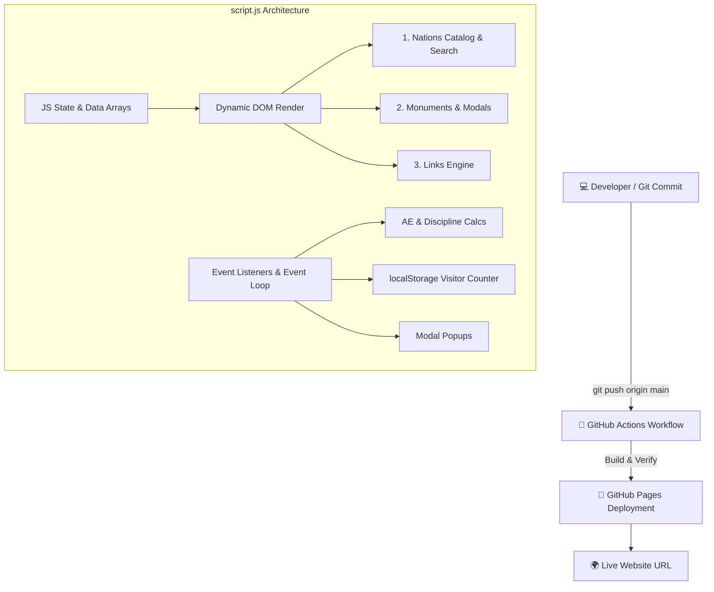

# 👑 ★ EUROPA UNIVERSALIS IV — REACT SPA WIKI ★

> **GREETINGS, MY LIEGE!** ⚔️
> Вы вступили на земли интерактивной базы знаний по Europa Universalis IV, построенной на современном стеке **React, JSX и Single Page Application (SPA)** архитектуре. Anno Domini 1444.

```text
╔════════════════════════════════════════════════════════════════╗
║                     PAX  PARADOXICA  1444                      ║
╠════════════════════════════════════════════════════════════════╣
║                                                                ║
║     🏰  MAP  •  DIPLOMACY  •  WARFARE  •  MONUMENTS  🏰        ║
║                                                                ║
║            "Comet Sighted! (-1 Stability)"                     ║
║                                                                ║
║        React Virtual DOM & State Management Activated          ║
║                                                                ║
╚════════════════════════════════════════════════════════════════╝

## 📜 Что это за проект?

Это статический веб-сайт и динамическое веб-приложение по **EU4**, созданное в рамках индивидуального учебного проекта с глубоким упором на **JavaScript (ES6+)** и автодеплоем через **CI/CD** на **GitHub Pages**.

### ⚡ JavaScript Features & Architecture:
- 📦 **Data-Driven Architecture:** Вся база данных стран, монументов и ресурсов хранится в виде массивов объектов в `script.js`.
- 🛠️ **Dynamic DOM Generation:** Карточки, списки и кнопки генерируются "на лету" с помощью `document.createElement()` и `innerHTML`.
- 🪟 **Interactive Modals:** При клике на любую карточку страны или постройки вызывается динамическое модальное окно.
- 🔍 **Real-Time Search Engine:** Живой поиск и фильтрация данных через методы массивов (`.filter()`, `.includes()`).
- 💾 **Persistent Session Counter:** Использование `localStorage` браузера для отслеживания количества заходов пользователя.
- 🧮 **Interactive Calculators:** Калькулятор Агрессивного Расширения (AE) и калькулятор Дисциплины с динамическим пересчётом.

---

## 🌐 LIVE WEBSITE

🚀 **Завоевать мир можно по этой ссылке:**


```text
╭────────────────────────────────────────────────────────╮
│  🏰 YOU ARE CURRENTLY RULING THE EMPIRE                │
│                                                        │
│  ★ PRESTIGE: +100  │  MANA: 999  │  STABILITY: +3 ★     │
╰────────────────────────────────────────────────────────╯
```


---

## 🏛️ Структура сайта (5 Разделов)

Сайт разделен на **5 полноценных страниц/разделов**, переключение между которыми управляется через JS SPA-навигатор:

1. 🏠 **Главная:** Описание, **Счётчик посещений (localStorage)** и **Калькулятор AE**.
2. 🚩 **Интересные страны:** Динамически рендеримый каталог из 12 государств с фильтром поиска и поп-ап окнами.
3. 🗿 **Великие постройки:** Интерактивная база монументов (Собор Св. Софии, Альгамбра и др.).
4. ⚔️ **Игровые механики:** **Калькулятор Дисциплины** с чекбоксами и базовые концепции игры.
5. 🔗 **Полезные ссылки:** Сгенерированный из JS-массива список ресурсов сообщества.

---

## 📐 Структура проекта (Mermaid Diagram)



---

## 📁 Дерево файлов

```text
eu4-wiki-project/
│
├── .github/
│   └── workflows/
│       └── deploy.yml      # Настройки CI/CD автодеплоя
│
├── index.html              # Каркас страницы (HTML5)
├── style.css               # Стили, модальные окна и hover-анимации
├── script.js              # Основной движок сайта (JS / DOM / Data)
└── README.md               # Документация проекта
```

---

## 🤖 CI/CD Workflow

Проект использует **GitHub Actions** для автоматического обновления сайта при каждом пуше в ветку `main`:

```text
       GIT PUSH
          │
          ▼
┌──────────────────┐
│  GitHub Actions  │
│  Trigger Build   │
└────────┬─────────┘
         ▼
┌──────────────────┐
│ Upload Artifact  │
└────────┬─────────┘
         ▼
┌──────────────────┐
│  GitHub Pages    │
│    DEPLOYED! 🚀  │
└────────┬─────────┘
         ▼
      SUCCESS
```

Никакой ручной загрузки по FTP — всё происходит автоматически! 😎

---

## 📋 Чек-лист выполнения требований задания

| Требование | Статус | Описание |
| :--- | :---: | :--- |
| **Не менее 5 страниц** | ✅ | 5 динамических разделов с JS-переключением |
| **Упор на JavaScript** | ✅ | Рендеринг DOM, массивы данных, `localStorage`, обработчики событий |
| **README с Mermaid** | ✅ | Вы читаете этот файл |
| **Анимация и интерактив** | ✅ | Модальные окна, калькуляторы, поиск и hover-эффекты |
| **CI/CD деплой** | ✅ | GitHub Actions workflow настроен |
| **Прямые ссылки в About / Environments** | ⏳ | Укажите URL сайта в настройках репозитория (`About` -> `Website`) |
| **Не менее 3 коммитов и 3 deployments** | ⏳ | Сделайте 3 различных коммита для истории сборки |

---

## 🧪 Запуск и редактирование локально

Никаких сложных сборщиков не требуется. Просто откройте файл `index.html` в любом браузере:

```bash
# Клонировать репозиторий
git clone [https://github.com/](https://github.com/)<ВАШ-USERNAME>/<ИМЯ-РЕПОЗИТОРИЯ>.git

# Перейти в папку
cd <ИМЯ-РЕПОЗИТОРИЯ>

# Открыть в браузере (на Linux/Mac) или просто кликните на index.html
open index.html
```

---

## 🏆 Совместимость с браузерами

Сайт протестирован и стабильно работает в:

```text
✓ Google Chrome
✓ Mozilla Firefox
✓ Microsoft Edge
✓ Apple Safari
✓ Внутреннем браузере Императора Священной Римской Империи*
```
*\*Требуется поддержка ES6+ JavaScript.* 👑

---

```text
███████╗██╗   ██╗██╗  ██╗
██╔════╝██║   ██║██║  ██║
█████╗  ██║   ██║███████║
██╔══╝  ██║   ██║╚════██║
███████╗╚██████╔╝     ██║
╚══════╝ ╚═════╝      ╚═╝

★ THANK YOU FOR VISITING ★

Last updated: 1444 / 2026
Made with HTML5 + CSS3 + Pure ES6 JavaScript
Powered by Military Power & Excessive amounts of Coffee ☕
```