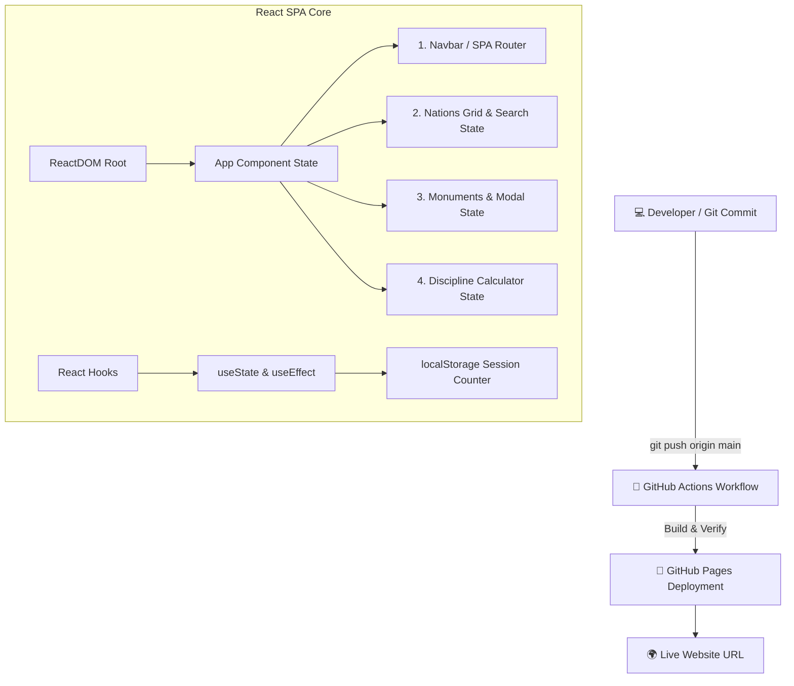

# 👑 ★ EUROPA UNIVERSALIS IV — REACT SPA WIKI ★

> **GREETINGS, MY LIEGE!** ⚔️
> Вы вступили на земли интерактивной базы знаний по Europa Universalis IV, построенной на современном стеке **React, JSX и Single Page Application (SPA)** архитектуре. Anno Domini 1444.

```text
╔════════════════════════════════════════════════════════════════╗
║                     PAX  PARADOXICA  1444                      ║
╠════════════════════════════════════════════════════════════════╣
║                                                                ║
║     🏰  MAP  •  DIPLOMACY  •  WARFARE  •  MONUMENTS  🏰        ║
║                                                                ║
║            "Comet Sighted! (-1 Stability)"                     ║
║                                                                ║
║        React Virtual DOM & State Management Activated          ║
║                                                                ║
╚════════════════════════════════════════════════════════════════╝
```

## 📜 Что это за проект?

Это передовое веб-приложение по **EU4**, созданное в рамках индивидуального учебного проекта с применением **React**, **JSX**, **SPA-маршрутизации** и автоматическим деплоем через **CI/CD (GitHub Actions)** на **GitHub Pages**.

### ⚛️ Technical Stack & Features:
- 🧩 **React Components:** Модульная архитектура пользовательского интерфейса на переиспользуемых компонентах.
- ⚡ **JSX & Virtual DOM:** Декларативное описание разметки и эффективное обновление DOM-дерева через reconciliation.
- 🪟 **State Management (React Hooks):** Управление состоянием приложения с помощью `useState` и жизненным циклом через `useEffect`.
- 🌐 **Single Page Application (SPA):** Мгновенное переключение между 5 разделами сайта без перезагрузки страниц.
- 🔍 **Real-Time Filtering:** Реактивный поиск по массивам данных с использованием функциональных методов JavaScript.
- 💾 **Persistent Storage:** Интеграция с `localStorage` для отслеживания сессий пользователя.

---

## 🌐 LIVE WEBSITE

🚀 **Завоевать мир можно по этой ссылке:**


```text
╭────────────────────────────────────────────────────────╮
│  🏰 YOU ARE CURRENTLY RULING THE EMPIRE                │
│                                                        │
│  ★ PRESTIGE: +100  │  MANA: 999  │  STABILITY: +3 ★     │
╰────────────────────────────────────────────────────────╯
```

*(Замените ссылку выше на ваш реальный URL после деплоя!)*

---

## 🏛️ Структура SPA (5 Разделов)

Приложение разделено на **5 реактивных разделов**, управляемых состоянием `currentSection`:

1. 🏠 **Главная:** Описание концепции Virtual DOM, **счётчик посещений (localStorage)** и калькулятор AE.
2. 🚩 **Интересные страны:** Список государств, отрендеренный через JSX mapping с живым поиском и модальными окнами.
3. 🗿 **Великие постройки:** Интерактивная база монументов с всплывающими поп-апами.
4. ⚔️ **Игровые механики:** Калькулятор Дисциплины армии на React State.
5. 🔗 **Полезные ссылки:** Ссылки на сообщество, сгенерированные декларативно.

---

## 📐 Структура проекта (Mermaid Diagram)



---

## 📁 Дерево файлов репозитория

```text
eu4-react-wiki/
│
├── .github/
│   └── workflows/
│       └── deploy.yml      # Настройки CI/CD автодеплоя через GitHub Actions
│
├── index.html              # Точка входа SPA с подключением React, ReactDOM и Babel
├── style.css               # Стили интерфейса, анимации и модальные окна
├── script.js               # React компоненты, JSX и логика State Management
└── README.md               # Документация проекта
```

---

## 🤖 CI/CD Workflow (`deploy.yml`)

Для автодеплоя используется стандартный конфиг GitHub Actions:

```yaml
name: Deploy static site to GitHub Pages

on:
  push:
    branches: ["main"]

permissions:
  contents: read
  pages: write
  id-token: write

concurrency:
  group: "pages"
  cancel-in-progress: true

jobs:
  deploy:
    environment:
      name: github-pages
      url: ${{ steps.deployment.outputs.page_url }}
    runs-on: ubuntu-latest
    steps:
      - name: Checkout
        uses: actions/checkout@v4
      - name: Setup Pages
        uses: actions/configure-pages@v5
      - name: Upload artifact
        uses: actions/upload-pages-artifact@v3
        with:
          path: '.'
      - name: Deploy to GitHub Pages
        id: deployment
        uses: actions/deploy-pages@v4
```

---

## 📋 Чек-лист выполнения требований задания

| Требование | Статус | Описание |
| :--- | :---: | :--- |
| **React & JSX** | ✅ | Используется полноценный React-стек и компоненты |
| **SPA (Single Page Application)** | ✅ | Мгновенная навигация без перезагрузки страниц |
| **Virtual DOM & State Management** | ✅ | Активное использование хуков `useState` и `useEffect` |
| **Не менее 5 страниц/разделов** | ✅ | 5 динамических разделов приложения |
| **README с Mermaid** | ✅ | Полная документация с диаграммой |
| **CI/CD деплой** | ✅ | Автоматический деплой через GitHub Actions |
| **Прямые ссылки в About / Environments** | ⏳ | Укажите URL сайта в настройках репозитория |
| **Не менее 3 коммитов и деплоев** | ⏳ | Сделайте 3 последовательных пуша в репозиторий |

---

```text
███████╗██╗   ██╗██╗  ██╗
██╔════╝██║   ██║██║  ██║
█████╗  ██║   ██║███████║
██╔══╝  ██║   ██║╚════██║
███████╗╚██████╔╝     ██║
╚══════╝ ╚═════╝      ╚═╝

★ THANK YOU FOR VISITING ★

Last updated: 1444 / 2026
Made with React 18, JSX, SPA Architecture & Pure Virtual DOM
Powered by State Management & Excessive amounts of Coffee ☕
```