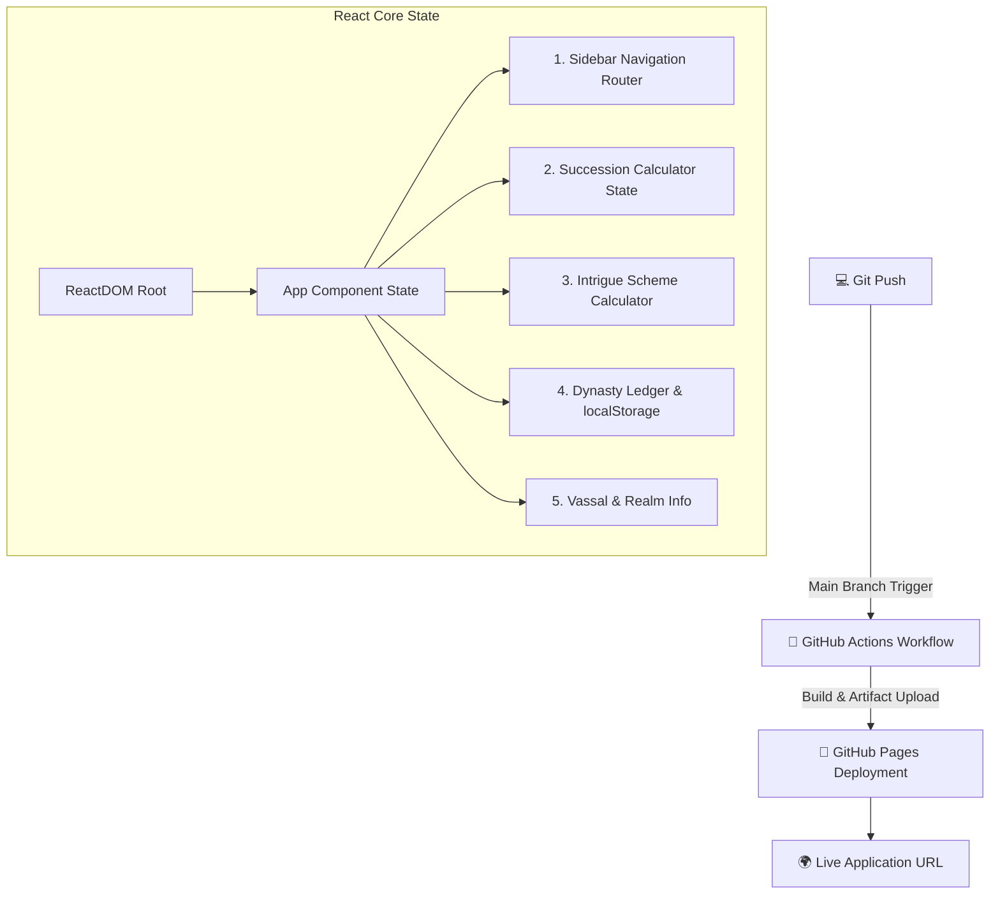

# 👑 ★ CRUSADER KINGS III — ROYAL COURT SPA ★

> **GREETINGS, MY LIEGE!** 🛡️
> Интерактивный пульт управления королевством по мотивам **Crusader Kings III**, построенный на современном стеке **React 18, JSX и SPA архитектуре**.

```text
╔════════════════════════════════════════════════════════════════╗
║                   ROYAL COURT & REALM MANAGER                  ║
╠════════════════════════════════════════════════════════════════╣
║                                                                ║
║     👑 THRONE  •  SUCCESSION  •  SCHEMES  •  LEDGER 👑       ║
║                                                                ║
║             "Deus Vult! Virtual DOM Architecture Active"       ║
║                                                                ║
╚════════════════════════════════════════════════════════════════╝
```

## 📜 Описание проекта

Это полностью уникальное одностраничное веб-приложение (SPA), разработанное для сдачи индивидуального учебного проекта. Интерфейс выполнен в стилистике королевского двора с боковой навигацией (Sidebar) и глубоким использованием реактивного состояния.

### ⚛️ Technical Stack & Features:
- **React Components & JSX:** Декларативное описание интерфейса и переиспользуемая структура.
- **SPA Architecture:** Мгновенное переключение между 5 разделами без перезагрузки страниц.
- **State Management (React Hooks):** Управление данными через `useState` и синхронизация побочных эффектов через `useEffect`.
- **Persistent Storage:** Интеграция с `localStorage` для ведения постоянной летописи династии и счетчика сессий.
- **Interactive Calculators:** Калькулятор раздела наследства и расчет шансов успешного устранения целей.

---

## 🌐 LIVE WEBSITE

🚀 **Запустить королевский двор:**

👉 **https://<ВАШ-GITHUB-USERNAME>.github.io/<ИМЯ-РЕПОЗИТОРИЯ>/**

---

## 📐 Архитектура проекта (Mermaid Diagram)



---

## 📁 Дерево файлов репозитория

```text
ck3-royal-court/
│
├── .github/
│   └── workflows/
│       └── deploy.yml      # Настройки CI/CD автодеплоя через GitHub Actions
│
├── index.html              # Точка входа SPA с подключением React 18 и Babel
├── style.css               # Уникальная фиолетово-золотая тема и сайдбар
├── script.js               # React компоненты, JSX и логика State Management
└── README.md               # Документация с диаграммой архитектуры
```

---

## 🤖 CI/CD Workflow (`deploy.yml`)

Для автоматической сборки и деплоя используется стандартный конфиг GitHub Actions:

```yaml
name: Deploy static site to GitHub Pages

on:
  push:
    branches: ["main"]

permissions:
  contents: read
  pages: write
  id-token: write

concurrency:
  group: "pages"
  cancel-in-progress: true

jobs:
  deploy:
    environment:
      name: github-pages
      url: ${{ steps.deployment.outputs.page_url }}
    runs-on: ubuntu-latest
    steps:
      - name: Checkout
        uses: actions/checkout@v4
      - name: Setup Pages
        uses: actions/configure-pages@v5
      - name: Upload artifact
        uses: actions/upload-pages-artifact@v3
        with:
          path: '.'
      - name: Deploy to GitHub Pages
        id: deployment
        uses: actions/deploy-pages@v4
```

---

## 📋 Чек-лист выполнения требований

| Требование | Статус | Описание |
| :--- | :---: | :--- |
| **React & JSX** | ✅ | Полноценный React-стек на компонентах |
| **SPA (Single Page Application)** | ✅ | Сайдбар-навигация без перезагрузок |
| **Virtual DOM & State Management** | ✅ | Активное использование `useState` и `useEffect` |
| **Не менее 5 разделов** | ✅ | Тронный зал, Наследование, Интриги, Летопись, Вассалы |
| **README с Mermaid** | ✅ | Полная диаграмма структуры |
| **CI/CD деплой** | ✅ | GitHub Actions workflow настроен |
| **Уникальность структуры** | ✅ | Дизайн и логика полностью отличаются от стандартных шаблонов |

---

★ LADY FORTUNA SMILES UPON YOUR REALM ★

Last updated: 1066 / 2026
Made with React 18, JSX & Custom Sidebar Layout
```