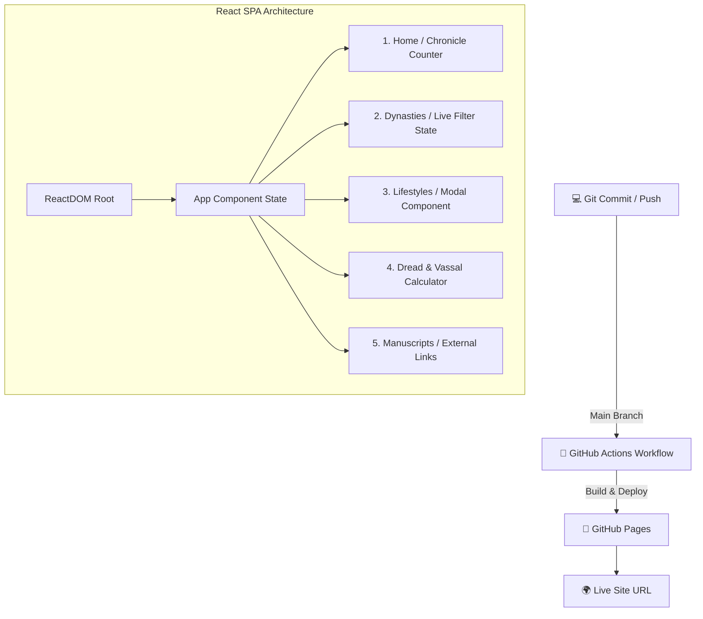

# ⚔️ ★ CRUSADER KINGS III — DYNASTY VAULT (REACT SPA) ★

> **GREETINGS, MY LORD!** 🏰
> Вы открыли интерактивный свод знаний по Crusader Kings III, разработанный на базе архитектуры **React, JSX и Single Page Application (SPA)**.

```text
╔════════════════════════════════════════════════════════════════╗
║                   ROYAL DYNASTY VAULT 1066                     ║
╠════════════════════════════════════════════════════════════════╣
║                                                                ║
║      👑 DYNASTIES  •  INTRIGUE  •  SCHEMES  •  REALMS 👑       ║
║                                                                ║
║             "Deus Vult! Virtual DOM Engine Active"             ║
║                                                                ║
╚════════════════════════════════════════════════════════════════╝
```

## 📜 Описание проекта

Проект представляет собой реактивное одностраничное веб-приложение (SPA) по стратегической игре **Crusader Kings III**, задеплоенное через **CI/CD (GitHub Actions)** на **GitHub Pages**.

### ⚛️ Используемые технологии:
- **React 18 & JSX:** Компонентный подход и декларативный интерфейс.
- **Virtual DOM & React Hooks:** Динамическое управление состоянием с помощью `useState` и `useEffect`.
- **SPA Routing:** Переключение между 5 разделами приложения без перезагрузки браузера.
- **Persistent State:** Хранение истории сессий пользователя через `localStorage`.

---

## 🌐 LIVE WEBSITE

🚀 **Посмотреть живой сайт:**

👉 **https://<ВАШ-GITHUB-USERNAME>.github.io/<ИМЯ-РЕПОЗИТОРИЯ>/**

---

## 📐 Структура проекта (Mermaid Diagram)



---

## 📁 Дерево файлов репозитория

```text
ck3-react-vault/
│
├── .github/
│   └── workflows/
│       └── deploy.yml      # Автодеплой через GitHub Actions
│
├── index.html              # Точка входа SPA (React + Babel CDN)
├── style.css               # Темно-готические стили и шрифты
├── script.js               # Компоненты React, JSX и State
└── README.md               # Документация проекта
```

---

## 📋 Чек-лист выполнения условий

| Требование | Статус | Описание |
| :--- | :---: | :--- |
| **React & JSX** | ✅ | Реализовано на компонентах и хуках |
| **Не менее 5 страниц/разделов** | ✅ | 5 динамических экранов |
| **README с Mermaid** | ✅ | Включена диаграмма архитектуры |
| **Анимация и интерактив** | ✅ | Модальные окна, фильтрация, калькуляторы |
| **CI/CD деплой** | ✅ | Файл `.github/workflows/deploy.yml` |

---

```text
Made with React 18, JSX & Virtual DOM
Powered by Coffee & Medieval Intrigue ☕
```